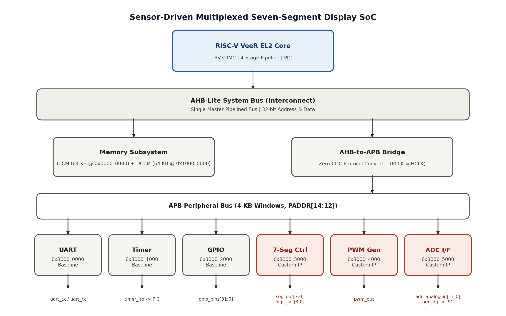
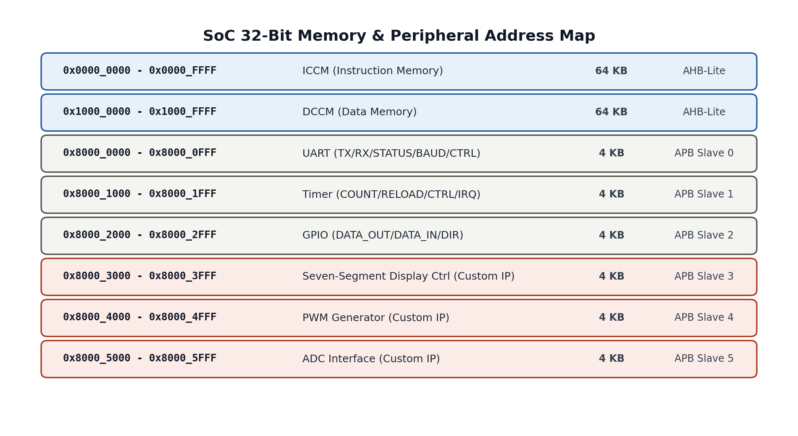
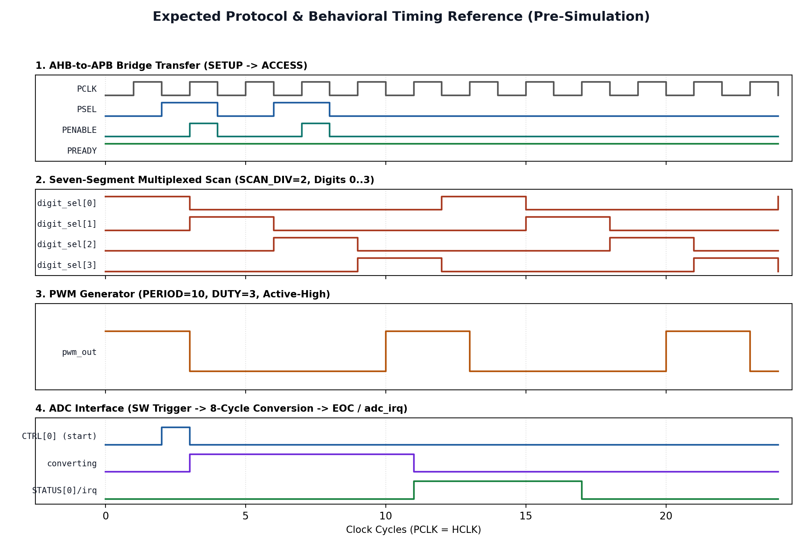
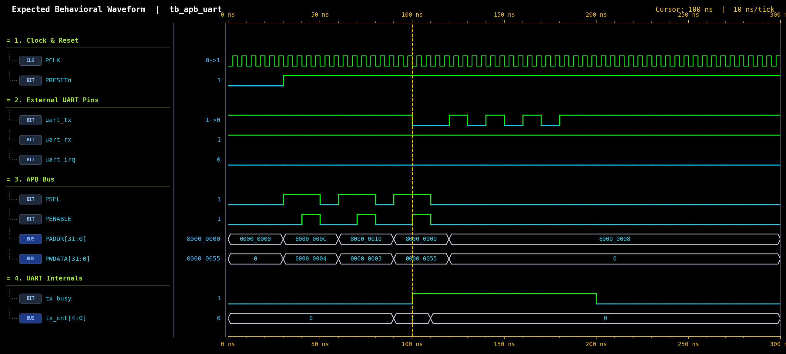
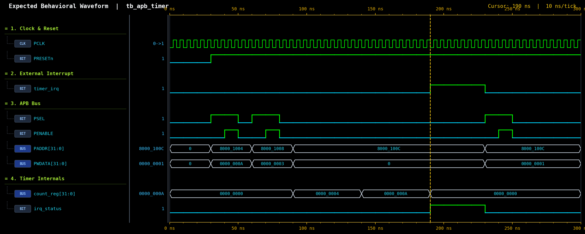
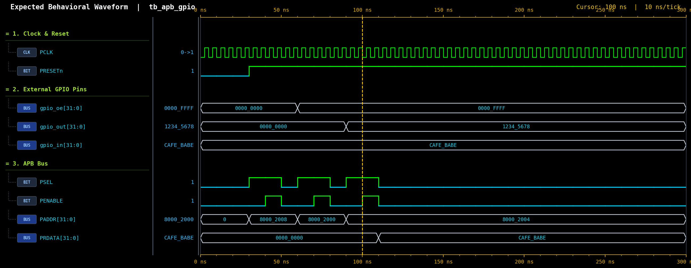
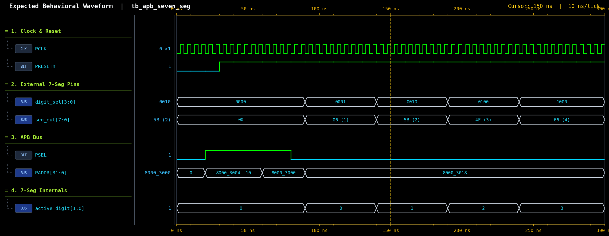
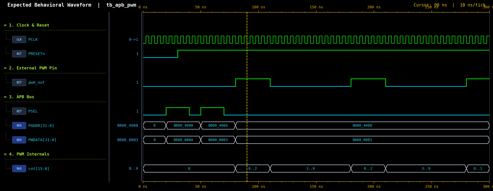
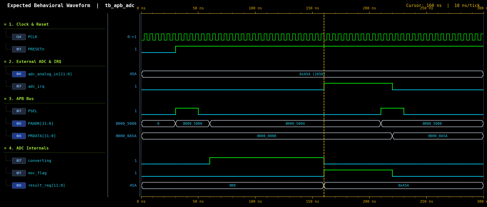
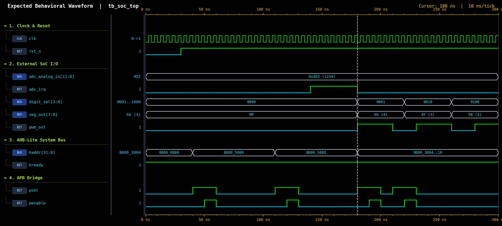

# Sensor-Driven Multiplexed Seven-Segment Display SoC (RISC-V VeeR EL2)

A compact, synthesizable System-on-Chip (SoC) built around the **CHIPS Alliance RISC-V VeeR EL2** (`RV32IMC`) processor core. The SoC digitizes an external analog input via a memory-mapped ADC interface, formats the reading into BCD digits in bare-metal firmware, and drives a 4-digit multiplexed seven-segment display with PWM-controlled brightness.

## Key Features
- **RISC-V VeeR EL2 Core (`RV32IMC`):** 4-stage scalar in-order pipeline, Machine-mode (M-mode), integrated Programmable Interrupt Controller (PIC), and native AHB-Lite system bus.
- **AHB-Lite to APB Bus Architecture:** Direct AHB-Lite access to 64 KB ICCM (`0x0000_0000`) and 64 KB DCCM (`0x1000_0000`), plus a zero-CDC AHB-to-APB bridge (`PCLK = HCLK`) fanning out to six 4 KB APB peripherals.
- **Required Baseline Peripherals:** UART (`0x8000_0000`), Timer (`0x8000_1000`), and 32-bit GPIO (`0x8000_2000`).
- **Custom Application IPs:**
  - **Seven-Segment Display Controller (`0x8000_3000`):** 4-digit time-multiplexed controller with BCD auto-decode / raw segment mode and programmable scan-rate divider.
  - **PWM Generator (`0x8000_4000`):** 16-bit programmable period, duty cycle, and output polarity for display brightness or indicator LEDs.
  - **ADC Interface (`0x8000_5000`):** 12-bit ADC interface supporting software-triggered and periodic auto-sampling modes with end-of-conversion interrupt.
- **Full Verification & Firmware Stack:** Block-level SystemVerilog testbenches, UVM agents/environments/scoreboards, SV assertions, CSV testplans, and bare-metal RISC-V C/assembly firmware.

## SoC Architecture



### Top-Level External Interfaces
| Signal | Width | Direction | Description |
| :--- | :--- | :--- | :--- |
| `clk` | 1 | Input | System clock (`HCLK = PCLK`) |
| `rst_n` | 1 | Input | Active-low system reset |
| `uart_tx` | 1 | Output | UART serial transmit |
| `uart_rx` | 1 | Input | UART serial receive |
| `gpio_in` / `gpio_out` / `gpio_oe` | 32 | In / Out | General-purpose digital I/O |
| `seg_out` | 8 | Output | Shared 7-segment lines (`a-g` + `dp`) |
| `digit_sel` | 4 | Output | Multiplexed digit-select lines |
| `pwm_out` | 1 | Output | Brightness / indicator PWM output |
| `adc_analog_in` | 12 | Input | External analog / behavioral ADC stimulus |

## Memory Map Summary



| Region | Base Address | Size | Bus | Notes |
| :--- | :--- | :--- | :--- | :--- |
| ICCM (Instruction) | `0x0000_0000` | 64 KB | AHB-Lite | Core-local instruction memory |
| DCCM (Data) | `0x1000_0000` | 64 KB | AHB-Lite | Core-local data memory |
| UART | `0x8000_0000` | 4 KB | APB | Baseline: host serial & debug |
| Timer | `0x8000_1000` | 4 KB | APB | Baseline: periodic IRQ & time base |
| GPIO | `0x8000_2000` | 4 KB | APB | Baseline: 32-bit digital I/O |
| Seven-Segment Display Ctrl | `0x8000_3000` | 4 KB | APB | Custom IP: 4-digit multiplexed display |
| PWM Generator | `0x8000_4000` | 4 KB | APB | Custom IP: brightness / indicator PWM |
| ADC Interface | `0x8000_5000` | 4 KB | APB | Custom IP: 12-bit ADC interface |

## Expected Protocol & Behavioral Timing Reference



> **Note:** The timing diagram above illustrates the expected cycle-level protocol and behavioral waveforms prior to local simulator execution. Once you run `run_xsim.bat` or `make sim_all` locally, capture your Vivado/Verdi waveform screenshots into `docs/images/`.

## Behavioral Waveform Reference (Testbench Outputs)

> **Note:** These dark-theme behavioral waveform diagrams show the expected signal transitions for each testbench. After running `make sim_unit sim_soc` or `run_xsim.bat` locally, you can overwrite these files with your captured simulator screenshots.

| Testbench | Expected Behavioral Waveform |
| :--- | :--- |
| `tb_apb_uart` |  |
| `tb_apb_timer` |  |
| `tb_apb_gpio` |  |
| `tb_apb_seven_seg` |  |
| `tb_apb_pwm` |  |
| `tb_apb_adc` |  |
| `tb_soc_top` |  |

## Quickstart Guide

### Prerequisites
- **Simulators:** AMD Xilinx Vivado XSIM (`xvlog`, `xelab`, `xsim`), Synopsys VCS, or Verilator.
- **Toolchain:** `riscv64-unknown-elf-gcc` (or `riscv32-unknown-elf-gcc`) supporting `-march=rv32imc -mabi=ilp32`.

### Build & Run Workflow
#### Option A: Synopsys VCS / Verilator (Linux)
```bash
make -C firmware all
make sim_all
```
#### Option B: AMD Xilinx Vivado XSIM (Windows / WSL)
```bat
run_xsim.bat
run_xsim_fw.bat
```

## Verification & Regression Status

| Suite | Scope | Status |
| :--- | :--- | :--- |
| `tb_apb_uart` | UART TX/RX FIFO & baud divider | Ready (Pending Local Run) |
| `tb_apb_timer` | Free-running & periodic IRQ | Ready (Pending Local Run) |
| `tb_apb_gpio` | 32-bit direction & I/O | Ready (Pending Local Run) |
| `tb_apb_seven_seg` | BCD/raw decode & 4-digit scan | Ready (Pending Local Run) |
| `tb_apb_pwm` | Period, duty cycle & polarity | Ready (Pending Local Run) |
| `tb_apb_adc` | SW trigger, auto-sample & EOC IRQ | Ready (Pending Local Run) |
| `tb_soc_top` | Full-SoC AHB-APB-Firmware loop | Ready (Pending Local Run) |
| `uvm_tb` | APB VIP + Custom IP UVM scoreboards | Ready (Pending Local Run) |

## Repository Structure

```text
soc-sensor-display-veer/
├── Makefile                # Master verification & build automation script
├── README.md               # Project overview, quickstart & architecture summary
├── docs/                   # Architectural specifications, register maps & guides
│   ├── images/             # System diagrams and block schematics (.png)
│   ├── Architecture_MicroArchitecture_Spec.md
│   ├── Register_Map.md
│   ├── clean_machine_setup_guide.md
│   ├── vcs_verdi_guide.md
│   └── SOC_VERIFICATION_AND_IP_REPORT.md
├── firmware/               # Bare-metal RISC-V C & assembly firmware
│   ├── start.S             # Core startup code (MRAC, stack pointer, BSS init)
│   ├── main.c              # SoC peripheral test suite & ADC-to-7Seg loop
│   └── link.ld             # Linker script (ICCM @ 0x00000000, DCCM @ 0x10000000)
├── rtl/                    # Synthesizable SystemVerilog source files
│   ├── soc_top.sv          # Top-level SoC integration
│   ├── core/               # CHIPS Alliance VeeR EL2 core integration & 64/32 AHB adapter
│   ├── custom_ips/         # Custom IPs (apb_seven_seg, apb_pwm, apb_adc)
│   ├── interconnect/       # AHB-Lite/APB interfaces, bridge, decoder, ICCM/DCCM
│   └── ips/                # Baseline peripherals (apb_uart, apb_timer, apb_gpio)
├── tb/                     # Verification testbenches (unit & full SoC)
├── scripts/                # Automation and firmware hex scripts
└── waves/                  # Synopsys Verdi waveform signal list configurations (.rc)
```

## Documentation Hub
- [Project Proposal](docs/Project_Proposal.md)
- [Architecture & Micro-Architecture Specification](docs/Architecture_MicroArchitecture_Spec.md)
- [UVM Verification Architecture](docs/UVM_Architecture.md)
- [Complete Hardware Register Map](docs/Register_Map.md)
- [Memory Map (All IPs)](docs/MEMORY_MAP_ALL_IPS.md)
- [SoC Verification & IP Report](docs/SOC_VERIFICATION_AND_IP_REPORT.md)
- [Clean Machine Setup Guide (GitHub & RISC-V Toolchain)](docs/clean_machine_setup_guide.md)
- [Test Plan (CSV)](docs/Testplan.csv)
- [VIP & Interface Signals Inventory (CSV)](docs/vip_interface_signals.csv)

## License & Acknowledgements
Built around the [CHIPS Alliance RISC-V VeeR EL2](https://github.com/chipsalliance/Cores-VeeR-EL2) core (Apache-2.0). 
